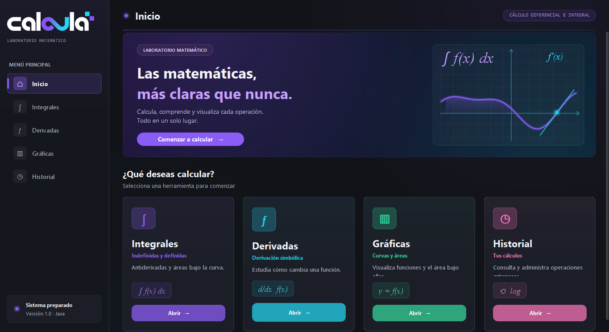
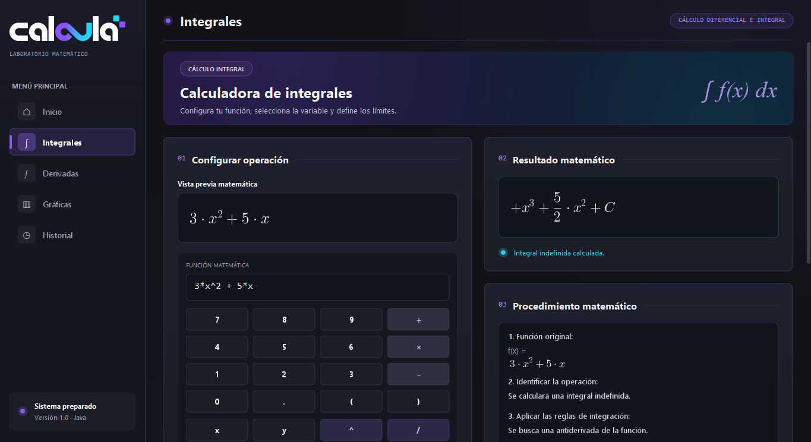
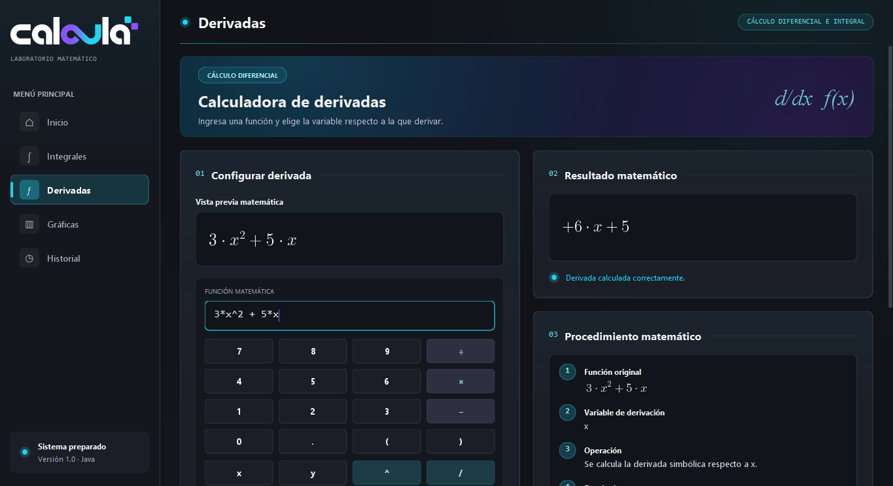
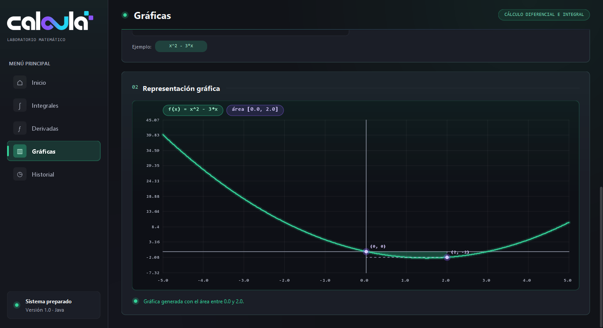

<div align="center">

  <!-- LOGO: guarda tu logo como docs/logo-calcula.png y ajusta la ruta si hace falta -->
  

  <h1>CALCULA</h1>
  <p><strong>Laboratorio Matemático</strong></p>
  <p>Una aplicación de escritorio para calcular, explorar y visualizar operaciones matemáticas.</p>

  <p>
    
    
    
    
  </p>

</div>

---

## Sobre el proyecto

**CALCULA** es una aplicación de escritorio desarrollada en Java con una interfaz gráfica basada en Swing. Reúne herramientas para trabajar con expresiones matemáticas mediante cálculo simbólico y visualización gráfica.

El proyecto utiliza Maven para gestionar sus dependencias y puede distribuirse para Windows como una aplicación portátil o mediante un instalador con runtime de Java incluido.

## Funcionalidades

- **Integrales:** cálculo de integrales definidas e indefinidas.
- **Derivadas:** cálculo simbólico de derivadas.
- **Gráficas:** representación visual de funciones y del área asociada a integrales definidas.
- **Historial:** consulta de operaciones anteriores.
- **Procedimiento matemático:** visualización de información sobre el proceso de cálculo.
- **Interfaz gráfica:** navegación entre los módulos desde una ventana principal.
- **Teclado matemático:** entrada de expresiones mediante botones de símbolos y funciones, si está disponible en la versión publicada.
- **Distribución para Windows:** empaquetado con `jpackage`.

## Tecnologías

| Tecnología | Uso |
|---|---|
| Java 21 | Lenguaje y entorno de ejecución |
| Java Swing | Interfaz gráfica de escritorio |
| Maven | Gestión de dependencias y construcción |
| Symja (`matheclipse-core`) | Cálculo simbólico |
| JLaTeXMath | Renderizado de expresiones matemáticas |
| `jpackage` | Empaquetado de la aplicación para Windows |

## Capturas de pantalla

<div align="center">
  
  <p><em>Pantalla de inicio</em></p>
</div>

<div align="center">
  
  <p><em>Módulo de integrales</em></p>
</div>

<div align="center">
  
  <p><em>Módulo de derivadas</em></p>
</div>

<div align="center">
  
  <p><em>Módulo de gráficas</em></p>
</div>

## Requisitos

### Para desarrollar desde el código fuente

- JDK 21.
- Apache Maven o un IDE compatible con proyectos Maven, como Apache NetBeans.
- Conexión a Internet la primera vez que Maven descargue las dependencias.

### Para utilizar la versión empaquetada

Usa el instalador de Windows o la carpeta portátil publicada en **Releases**. La distribución preparada con `jpackage` incluye su propio runtime de Java, por lo que no debería requerir una instalación de Java independiente.

## Ejecutar desde el código fuente

1. Clona el repositorio:

   ```bash
   git clone https://github.com/SrJuanManuel/CALCULA.git
   ```

2. Entra en la carpeta:

   ```bash
   cd CALCULA
   ```

3. Compila el proyecto:

   ```bash
   mvn clean package
   ```

4. Ejecuta el JAR generado, si la configuración del proyecto produce un JAR ejecutable con dependencias:

   ```bash
   java -jar target/CALCULA.jar
   ```

## Descargar CALCULA

Consulta **Releases** en este repositorio para encontrar las versiones publicadas:

- **Instalador de Windows:** archivo `.exe` para instalar la aplicación.
- **Versión portátil:** carpeta de la aplicación con su runtime incluido.

Cuando publiques tu primera versión, podrás adjuntar allí los archivos de distribución.

## Estructura general

```text
CalculadoraIntegrales/
├── src/
│   └── main/
│       ├── java/
│       │   └── com/calculadora/
│       │       ├── matematicas/
│       │       ├── controlador/
│       │       ├── modelo/
│       │       ├── servicios/
│       │       └── vista/
│       └── resources/
├── docs/
│   ├── logo-calcula.png
│   └── screenshots/
├── pom.xml
└── README.md
```

## Objetivo

CALCULA busca reunir herramientas de cálculo matemático en una interfaz accesible, combinando resultados simbólicos, representación gráfica y consulta de operaciones anteriores.

## Autoría

Desarrollado como proyecto académico de programación.

- **Autores:** `Juan Gaspar Manuel Pablo Sisay`
               `Henry Bernabé Chiroy Sulugüí`
               `Guillermo Josue Garcia de Leon`
- **Institución:** `Universidad Mariano Gálvez de Guatemala`


<div align="center">
  <sub>CALCULA · Laboratorio Matemático</sub>
</div>
